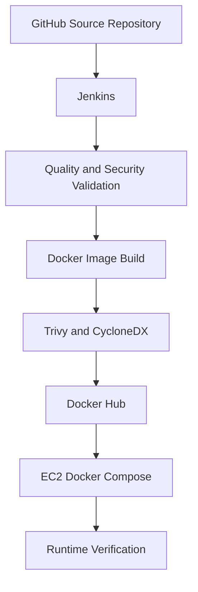
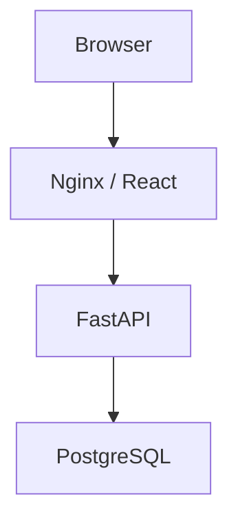

# RenewGrid — Jenkins CI/CD Architecture and Operations

**Elevate Labs | DevOps Internship — Task 2**

## 1. Purpose

This project implements a Jenkins-based continuous integration and continuous delivery pipeline for RenewGrid, a full-stack e-waste recycling application.

The objective is to automate the process of obtaining source code, validating application quality, creating container images, scanning for vulnerabilities, publishing release artifacts, deploying the application, and verifying its operational state.

The implementation extends the internship's basic Jenkins pipeline requirement with security gates, software bills of materials, versioned container publishing, database migrations, health checks, and recorded verification evidence.

### Project Scope

| Area                 | Implementation                                             |
| -------------------- | ---------------------------------------------------------- |
| Source repository    | GitHub                                                     |
| Pipeline definition  | Declarative Jenkinsfile                                    |
| CI/CD server         | Jenkins on Ubuntu EC2                                      |
| Automatic triggering | Git source change detection                                |
| Backend validation   | pytest                                                     |
| Frontend validation  | npm, Vite, ESLint                                          |
| Container builds     | Docker                                                     |
| Security scanning    | Trivy                                                      |
| SBOM format          | CycloneDX                                                  |
| Image registry       | Docker Hub                                                 |
| Deployment           | Docker Compose on EC2                                      |
| Database             | PostgreSQL                                                 |
| Database migrations  | Alembic                                                    |
| Verification         | Application, API, database-dependent, and container checks |

## 2. System Architecture

### 2.1 Delivery Flow



A source change detected by Jenkins initiates the pipeline.

The pipeline stops when a required stage fails. Docker Hub publication and deployment occur only after the preceding required checks succeed.

### 2.2 Application Request Flow



Nginx serves the compiled React application and forwards supported API routes to FastAPI through Docker's internal network.

FastAPI implements application business logic, authentication, authorization, uploads, and database operations.

PostgreSQL stores application data.

### 2.3 Docker Compose Services

| Service   | Function        | Runtime behavior                             |
| --------- | --------------- | -------------------------------------------- |
| `db`      | PostgreSQL      | Persistent database service                  |
| `migrate` | Alembic         | Runs migrations and exits                    |
| `api`     | FastAPI/Uvicorn | Serves the application API                   |
| `web`     | Nginx/React     | Serves the frontend and proxies API requests |

Startup dependencies ensure:

1. PostgreSQL becomes healthy.
2. Alembic migrations complete successfully.
3. FastAPI starts and passes its health check.
4. The frontend starts after the API is ready.

Database and upload data use Docker-managed named volumes.

## 3. Deployment Environment

### 3.1 AWS EC2

Jenkins and the demonstration deployment run on an Ubuntu-based AWS EC2 instance.

This is a single-host implementation intended for controlled demonstration and verification.

It does not provide high availability or isolation equivalent to separate production build and deployment environments.

### 3.2 Network Access

| Component          | Access model                          |
| ------------------ | ------------------------------------- |
| Jenkins dashboard  | SSH tunnel; local access on port 8081 |
| RenewGrid frontend | SSH tunnel; local access on port 8080 |
| FastAPI            | Internal Docker network               |
| PostgreSQL         | Internal Docker network               |
| Docker Hub         | Outbound registry access              |
| GitHub             | Outbound repository access            |

The application frontend is bound to the instance's loopback interface.

The PostgreSQL service does not publish its database port to the public internet.

No purchased domain, public application load balancer, or public Jenkins endpoint is required.

### 3.3 Local and Cloud Deployment

Two deployment contexts exist:

- **Local Docker Compose:** Developers can build and run the application locally using the repository's Compose configuration.
- **Jenkins-managed EC2 deployment:** Jenkins publishes versioned Docker images and deploys those images to the EC2-hosted Compose environment.

These are distinct workflows. A successful local run does not replace the Jenkins deployment verification.

## 4. Jenkins Pipeline Design

The repository contains a root-level `Jenkinsfile` using Jenkins Declarative Pipeline syntax.

The implementation organizes delivery into ten stages.

### Stage 1 — Checkout

**Purpose:** Retrieve the repository source at the commit selected for the build.

**Why it matters:** Each pipeline execution must be associated with a specific Git revision. This allows the test results, generated images, and deployment to be traced to the code that produced them.

**Verified result:** Build #7 checked out:

```text
81860ebf42a1781fdcccfaa2fa3a21538be32a0e
```

from `main`.

### Stage 2 — Secret Scan

**Purpose:** Execute repository secret-scanning checks before building and publishing images.

**Why it matters:** Accidentally committed credentials can expose systems and services. Scanning before publication helps detect credential-related issues earlier in the delivery process.

**Verified result:** The stage completed successfully in Build #7.

The scan should be interpreted according to its configured scope; stage success is not a guarantee that every possible secret has been detected.

### Stage 3 — Backend Tests

**Purpose:** Validate backend behavior using pytest.

**Why it matters:** Automated tests provide a repeatable quality gate. Failures prevent unverified application changes from proceeding to image publication and deployment.

**Verified result:**

```text
26 passed, 3 warnings in 2.24s
```

Jenkins also archived JUnit-formatted test results.

### Stage 4 — Frontend Validation

**Purpose:** Verify that the React frontend can install dependencies, produce a build, and pass lint checks.

**Operations:**

1. Install dependencies with `npm ci`.
2. Build the frontend using Vite.
3. Execute ESLint.

**Why it matters:** Reproducible dependency installation and automated static checks catch frontend integration problems before container publication.

**Verified result:** Vite built the frontend successfully, and ESLint completed without a blocking error.

The build reported a bundle-size advisory, which is separate from a failed build.

### Stage 5 — Docker Build

**Purpose:** Build separate backend and frontend container images.

The backend image contains the FastAPI application and its Python runtime dependencies.

The frontend image contains the compiled React assets served through Nginx.

**Why it matters:** Containers package application code and required runtime components into independently deployable artifacts.

**Verified result:** Both images were successfully built for commit `81860ebf42a1`.

### Stage 6 — Image Security Scan

**Purpose:** Scan the built images for vulnerabilities before publication.

**Tool:** Trivy

**Why it matters:** Dependency and operating-system vulnerabilities can exist even when tests pass. The security gate prevents images with findings that violate the configured severity policy from progressing.

**Verified result:** The scan completed successfully for both images with no blocking HIGH or CRITICAL findings reported.

The result describes the scanned images and vulnerability database at the time of execution. It does not constitute a permanent guarantee that the images contain no vulnerabilities.

### Stage 7 — Generate SBOM

**Purpose:** Generate software bills of materials for the backend and frontend images.

**Format:** CycloneDX

**Why it matters:** An SBOM records identified software components and dependencies. It improves release traceability and supports later vulnerability investigations.

**Verified result:** Jenkins archived:

```text
api-sbom.json
web-sbom.json
```

Image vulnerability scanning is handled by the preceding dedicated security stage.

### Stage 8 — Docker Hub Publish

**Purpose:** Authenticate to Docker Hub and publish the validated container images.

**Why it matters:** A registry allows deployment environments to retrieve versioned image artifacts without rebuilding the application from source.

The image tags include an abbreviated Git commit identifier.

**Published images:**

```text
docker.io/fire2686/renewgrid-jenkins-api:sha-81860ebf42a1
docker.io/fire2686/renewgrid-jenkins-web:sha-81860ebf42a1
```

The pipeline recorded the published image digests as additional release references.

Jenkins supplies registry credentials through its credential-handling mechanism rather than requiring credentials in the repository.

### Stage 9 — Deploy to EC2

**Purpose:** Pull the published images and deploy the application through Docker Compose.

**Why it matters:** Deployment uses the artifacts produced by the validated pipeline rather than unrelated locally built images.

The deployment manages PostgreSQL, the migration job, the API, and the frontend.

**Verified result:**

- Backend and frontend images were pulled.
- PostgreSQL was healthy.
- The Alembic migration job exited successfully.
- The API became healthy.
- The frontend started.

### Stage 10 — Deployment Verification

**Purpose:** Check that the deployed application is functioning after startup.

**Why it matters:** Successful image publication does not prove that an application works after deployment. Runtime checks detect problems involving configuration, dependencies, migrations, networking, and application readiness.

**Verified result:**

```text
Frontend, API and database-dependent checks passed.
```

Jenkins Build #7 completed successfully.

## 5. Automatic Pipeline Triggering

The Jenkins job monitors the configured Git source for changes.

A detected source change initiates the pipeline without requiring a manual **Build Now** action.

The verified execution reports:

```text
Started by an SCM change
```

Build #7 checked out the `main` branch after the merge of Pull Request #11.

This demonstrates the automatic-trigger requirement of Task 2.

Because the Jenkins controller is not publicly exposed, SCM-based change detection is suitable for the demonstration environment.

### Documentation-Only Changes

The current pipeline can execute its complete delivery workflow after documentation changes are merged into `main`.

Build #7 demonstrates this behavior.

A future optimization is to distinguish application changes from documentation-only changes and avoid unnecessary image publication and deployment when application artifacts have not changed.

That optimization is not claimed as implemented in this verified build.

## 6. Container Image Management

### Backend Image

```text
docker.io/fire2686/renewgrid-jenkins-api:sha-81860ebf42a1
```

### Frontend Image

```text
docker.io/fire2686/renewgrid-jenkins-web:sha-81860ebf42a1
```

Commit-specific tags make it easier to associate images with Git revisions.

The registry also provides content-addressed image digests.

A tag can be reassigned unless registry immutability is enforced. The recorded digests provide stronger identification of the exact published manifests.

### Docker Hub Repositories

- [Backend repository](https://hub.docker.com/r/fire2686/renewgrid-jenkins-api)
- [Frontend repository](https://hub.docker.com/r/fire2686/renewgrid-jenkins-web)

## 7. Security and Reliability Controls

### 7.1 Implemented Controls

| Control                         | Purpose                                           |
| ------------------------------- | ------------------------------------------------- |
| Automated tests                 | Detect application regressions                    |
| Frontend linting                | Detect JavaScript and React code-quality problems |
| Repository secret scanning      | Identify potential credential exposure            |
| Trivy image scanning            | Detect known container vulnerabilities            |
| Non-root application containers | Reduce runtime privileges                         |
| Jenkins credentials binding     | Avoid hardcoding Docker Hub credentials in source |
| Internal database networking    | Restrict direct database exposure                 |
| Loopback-bound frontend         | Avoid unnecessary public application access       |
| Health checks                   | Validate service readiness                        |
| Alembic migration stage         | Apply schema changes before API startup           |
| Commit-specific image tags      | Improve release traceability                      |
| CycloneDX SBOMs                 | Record software components                        |
| JUnit and archived reports      | Preserve build verification evidence              |

### 7.2 Security Boundaries

Jenkins has access to the Docker environment required to build and deploy the application. On a single EC2 host, this creates a privileged operational boundary.

For production use, a more isolated Jenkins agent and deployment architecture would reduce the risks associated with running builds on the same host as the application.

The demonstration uses loopback access and SSH tunneling rather than publicly exposing Jenkins.

### 7.3 Remaining Production Requirements

The verified implementation does not claim:

- High availability.
- Public HTTPS access.
- Automated production rollback.
- Continuous vulnerability monitoring after publication.
- Automated database backup and recovery.
- Complete end-to-end functional test coverage.
- Full infrastructure isolation between CI and deployment.
- Production-level centralized monitoring and alerting.

These would require additional design, implementation, and verification.

## 8. Local Development with Docker Compose

### Prerequisites

- Git
- Docker Engine or Docker Desktop
- Docker Compose v2

### Clone

```bash
git clone https://github.com/Aoun62336/RenewGrid-Jenkins-CICD.git
cd RenewGrid-Jenkins-CICD
```

### Configure

```bash
cp .env.compose.example .env.compose
```

Replace the example values with independently generated credentials and secrets.

Do not commit `.env.compose`.

### Validate

```bash
docker compose --env-file .env.compose config --quiet
```

### Start

```bash
docker compose --env-file .env.compose up -d --build
```

### Inspect

```bash
docker compose --env-file .env.compose ps -a
```

### Verify the Web Server

```bash
curl --fail http://127.0.0.1:8080/nginx-health
```

### Inspect Logs

```bash
docker compose --env-file .env.compose logs --tail=100
```

### Stop

```bash
docker compose --env-file .env.compose down
```

Do not use volume-deletion options unless removing persistent application data is intentional.

## 9. EC2 Operational Verification

These commands are for an authorized operator connected to the demonstration EC2 instance.

Inspect the deployed services:

```bash
sudo docker compose \
  --env-file /opt/renewgrid/.env \
  -f /opt/renewgrid/compose.yaml \
  ps -a
```

Inspect recent service logs:

```bash
sudo docker compose \
  --env-file /opt/renewgrid/.env \
  -f /opt/renewgrid/compose.yaml \
  logs --tail=100
```

Inspect migration execution:

```bash
sudo docker compose \
  --env-file /opt/renewgrid/.env \
  -f /opt/renewgrid/compose.yaml \
  logs migrate
```

These commands inspect the deployment without rebuilding images or deleting persistent data.

Do not print production environment variables or credentials into public logs, screenshots, or documentation.

## 10. Troubleshooting and Lessons Learned

### 10.1 npm Cache Permission Failure

An early frontend validation run failed because npm attempted to create its cache directory at an unwritable location inside a non-root container.

The Jenkins logs reported:

```text
EACCES
path /.npm
```

The validation container was configured with a writable temporary home and npm cache location.

**Lesson:** Non-root execution requires writable locations for package caches, temporary files, and other build-time state.

### 10.2 Vulnerable Backend Dependencies

An earlier Trivy scan detected HIGH and CRITICAL vulnerabilities in outdated backend dependencies.

The affected dependency set was reviewed and updated with compatibility considerations, including the relationship between FastAPI and Starlette.

The resulting images were rebuilt and rescanned.

Build #7 subsequently completed the image security scan successfully.

**Lesson:** A successful application build does not guarantee that its dependencies satisfy a security policy. Dependency remediation must be accompanied by compatibility testing.

### 10.3 Dependency and Framework Warnings

The successful build still reported non-blocking warnings, including deprecated API usage in backend code and a frontend bundle-size advisory.

These are maintenance items, not evidence that the verified build failed.

**Lesson:** Build success and long-term maintainability are different concerns. Non-blocking warnings should be tracked and resolved according to their impact.

### 10.4 Registry Authentication Warning

Docker reported that its temporary authentication configuration was stored without encryption during registry login.

Jenkins masked the registry token in console output.

For stronger operational security, temporary Docker authentication files should be cleaned up reliably, or an appropriate credential helper should be configured.

**Lesson:** Credential masking in logs does not by itself guarantee secure handling of temporary credential files.

### 10.5 Documentation Changes Triggering Releases

The SCM-triggered Build #7 followed a documentation pull-request merge and still executed the full build, publication, and deployment workflow.

**Lesson:** CI/CD pipelines should eventually distinguish changes that require a new application release from changes that only affect documentation.

## 11. Execution Evidence

The verified pipeline execution is documented in:

**[Jenkins Build #7 — Verification Record](evidence/jenkins/jenkins-verification.md)**

The evidence includes:

- Successful Jenkins pipeline.
- Container security scanning.
- Backend Docker Hub image.
- Frontend Docker Hub image.
- EC2 deployment.
- Automatic SCM-triggered execution.

### Archived Jenkins Artifacts

Build #7 archived:

```text
api-deploy-ref.txt
api-push.txt
api-sbom.json
api-vulnerabilities.txt
backend-junit.xml
secrets.txt
web-deploy-ref.txt
web-push.txt
web-sbom.json
web-vulnerabilities.txt
```

These reports support the screenshots with machine-readable execution evidence.

## 12. Cost and Operational Scope

The demonstration uses open-source tooling, Docker Hub, and an existing EC2 instance.

No purchased domain or paid external CI/CD service is required for this implementation.

AWS charges may still apply to EC2 compute, attached storage, public IPv4 addresses, and applicable data transfer.

The demonstration instance should be stopped when it is not needed, with the remaining resources and billing reviewed separately.

## 13. Conclusion

RenewGrid Task 2 demonstrates an automated Jenkins delivery workflow using a functional full-stack application.

The pipeline integrates source change detection, tests, frontend validation, Docker builds, security scanning, SBOM generation, Docker Hub publication, deployment, and runtime verification.

The successful Jenkins Build #7 provides evidence that these stages completed for a specific Git revision.

The project also demonstrates practical CI/CD troubleshooting, dependency remediation, container networking, application health checks, and release traceability.

The implementation is suitable as a DevOps internship demonstration and a portfolio example of Jenkins-based application delivery, with documented limitations separating the demonstration from a production deployment.
