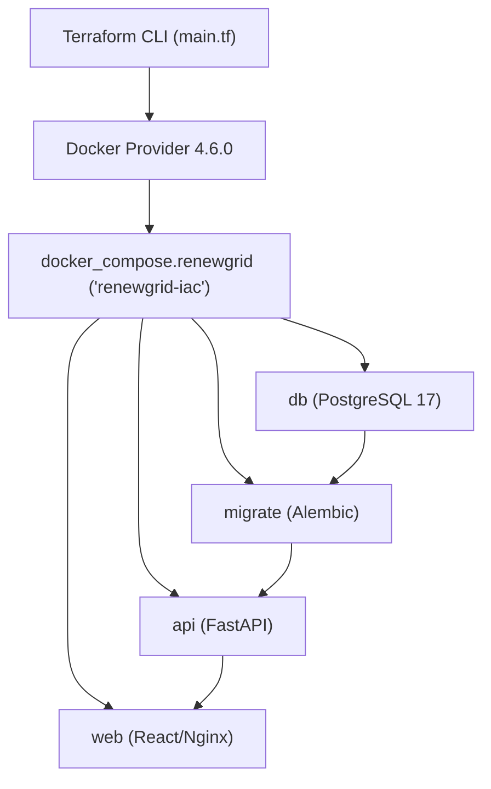
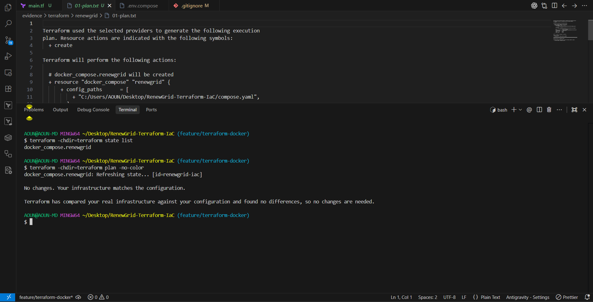
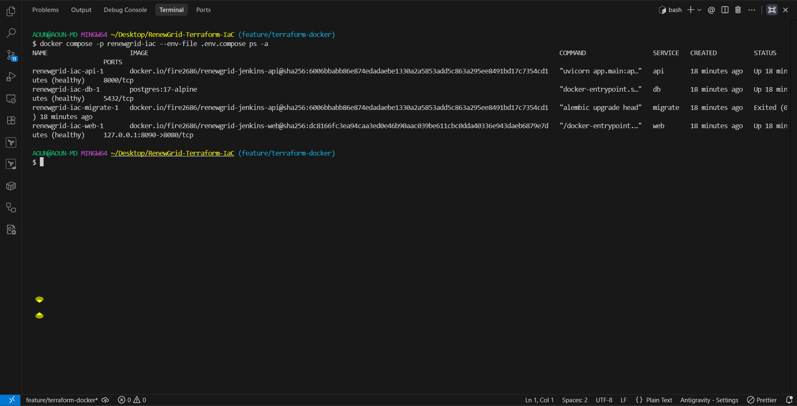
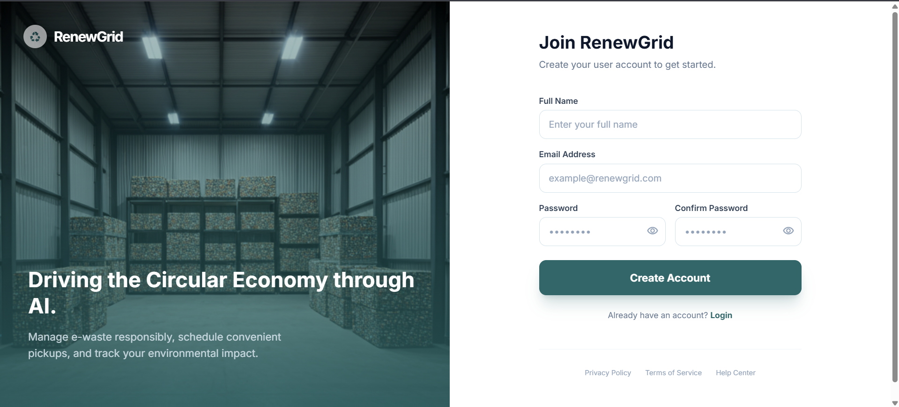

# RenewGrid — Terraform Infrastructure as Code

**Elevate Labs | DevOps Internship — Task 3**

## 1. Objective

The objective of Task 3 is to automate the local provisioning, state management, operational verification, and lifecycle teardown of the complete multi-tier RenewGrid application using Infrastructure as Code (IaC) with **Terraform** and the **Docker provider**.

## 2. Context & Task Evolution

RenewGrid is a full-stack e-waste management and recycling rewards platform built with React, FastAPI, PostgreSQL, and Alembic.

- **Task 1:** Established containerization and automated continuous integration using GitHub Actions and GitHub Container Registry (GHCR).
- **Task 2:** Built a robust automated Jenkins CI/CD pipeline on AWS EC2 featuring multi-stage validation, container image scanning (Trivy), SBOM generation (CycloneDX), Docker Hub image publishing, and automated EC2 deployment.
- **Task 3:** Implements Infrastructure as Code to manage the entire application infrastructure locally in a declarative, reproducible, and version-controlled manner using Terraform.

## 3. Terraform Architecture

The Terraform configuration resides in `terraform/main.tf` and utilizes:
- **Terraform Core:** `1.17.0` (pinned via `required_version = ">= 1.17.0, < 1.18.0"`)
- **Docker Provider:** `kreuzwerker/docker` version `4.6.0` (locked in `.terraform.lock.hcl`)



The `docker_compose` resource manages the existing `compose.yaml` specification under the project name `renewgrid-iac`:
- **Isolated Project Namespace:** Uses `project_name = "renewgrid-iac"` to prevent collisions with other local Docker projects.
- **Service Coordination:** Manages startup ordering where `db` becomes healthy first, `migrate` completes database migrations, `api` starts up and reports healthy, and `web` proxies incoming requests.
- **Explicit Timeout:** `wait_timeout = "10m"` ensures all image pulls and migration steps complete before marking the apply successful.

## 4. Container Images

To ensure release immutability and repeatability, the deployment reuses the verified, security-scanned container images published to Docker Hub during Jenkins Build #7:

- **Backend API:**
  ```text
  docker.io/fire2686/renewgrid-jenkins-api@sha256:6006bbabb86e874edadaebe1330a2a5853add5c863a295ee8491bd17c7354cd1
  ```
- **Frontend Web:**
  ```text
  docker.io/fire2686/renewgrid-jenkins-web@sha256:dc8166fc3ea94caa3ed0e46b90aac039be611cbc0dda40336e943daeb6879e7d
  ```

These digests are supplied via `API_IMAGE` and `WEB_IMAGE` in `.env.compose`.

## 5. Provisioning & Lifecycle Sequence

The IaC lifecycle consists of deterministic phases:

1. **Initialization:** `terraform -chdir=terraform init` initializes the provider plugin and locks dependencies.
2. **Formatting & Validation:** `terraform -chdir=terraform fmt -check` and `terraform -chdir=terraform validate` guarantee syntax compliance.
3. **Execution Plan:** `terraform -chdir=terraform plan -out=renewgrid.tfplan` generates an execution plan specifying 1 resource to add.
4. **Application:** `terraform -chdir=terraform apply "renewgrid.tfplan"` provisions the `docker_compose.renewgrid` resource.
5. **State Inspection:** `terraform -chdir=terraform state list` confirms state tracking.
6. **Reconciliation / Drift Check:** A subsequent `terraform plan` verifies zero configuration drift (`No changes. Your infrastructure matches the configuration.`).
7. **Destruction & Teardown:** `terraform -chdir=terraform destroy` removes all managed containers and networks while preserving persistent named volumes.

## 6. Security and Isolation

- **Loopback Port Binding:** Web application port `8090` binds strictly to `127.0.0.1` (`127.0.0.1:8090:8080`), avoiding accidental LAN or public exposure.
- **Database Network Isolation:** PostgreSQL is attached to an internal Docker network (`data`, `internal: true`) without host port bindings.
- **State File Protection:** Terraform state (`*.tfstate`, `*.tfstate.*`) and execution plans (`*.tfplan`, `tfplan`) are strictly excluded in `.gitignore` to prevent credential exposure.
- **Environment Management:** Real credentials reside in `.env.compose` which is excluded from source control. A sanitized `.env.compose.example` template is maintained for developer onboarding.
- **Provider Version Pinning:** Terraform and provider version bounds are locked in both `main.tf` and `.terraform.lock.hcl`.

## 7. CI/CD Validation

An automated GitHub Actions workflow (`.github/workflows/terraform-validate.yml`) validates every pull request and push to `main`:
- **Format Check:** `terraform fmt -check -recursive`
- **Provider Init:** `terraform init -backend=false -input=false -lockfile=readonly`
- **Configuration Validation:** `terraform validate -no-color`
- **Compose Linting:** `docker compose --env-file .env.compose.example config --quiet`

The validation workflow enforces static analysis without executing live applies in CI runners.

## 8. Verification & Health Checks

Runtime operational verification tests confirmed that:
- PostgreSQL passed container health checks (`pg_isready`).
- Alembic database migrations ran successfully to head.
- FastAPI passed internal health checks at `/nginx-health` and served public endpoints:
  - `GET http://127.0.0.1:8090/roles` → HTTP 200 (returns role definitions)
  - `GET http://127.0.0.1:8090/config` → HTTP 200 (returns application configuration)
- React frontend loaded successfully in the browser at `http://localhost:8090`.

## 9. Execution Evidence

All artifacts, command outputs, and screenshots are organized under `evidence/terraform/renewgrid/`.

### 9.1 Evidence Summary

| Evidence | Artifact File | Description |
|---|---|---|
| **Terraform Plan & Verification** | [01-terraform-verified.png](evidence/terraform/renewgrid/01-terraform-verified.png) | Successful Terraform init, validate, and execution plan |
| **Running Services** | [02-renewgrid-services.png](evidence/terraform/renewgrid/02-renewgrid-services.png) | All 4 Docker Compose services running and healthy |
| **Application in Browser** | [03-renewgrid-application.png](evidence/terraform/renewgrid/03-renewgrid-application.png) | RenewGrid UI active and functional at `http://localhost:8090` |
| **Plan Log** | [`01-plan.txt`](evidence/terraform/renewgrid/01-plan.txt) | CLI output for `terraform plan -out=renewgrid.tfplan` (1 to add) |
| **Apply Log** | [`02-apply.txt`](evidence/terraform/renewgrid/02-apply.txt) | CLI output for `terraform apply` (1 added in 18s) |
| **Reconciliation Log** | [`03-reconciliation.txt`](evidence/terraform/renewgrid/03-reconciliation.txt) | Verification of state convergence (0 changes detected) |
| **Destroy Log** | [`04-destroy.txt`](evidence/terraform/renewgrid/04-destroy.txt) | Clean resource teardown (1 destroyed in 2s) |

---

### 9.2 Visual Evidence

#### 1. Terraform Verification & Plan


#### 2. Running Docker Services


#### 3. RenewGrid Application in Browser


---

## 10. Scope and Limitations

- **Local Scope:** This implementation manages local Docker containers. It is tailored for local reproducible environments and development clusters.
- **Granularity:** Terraform manages the Docker Compose stack as a unified resource (`docker_compose`) rather than individual standalone containers, ensuring compose dependency trees and health checks are preserved natively.
- **State Storage:** Local state files are used for this demonstration; cloud team deployments would use a remote backend (such as AWS S3 with DynamoDB locking).
- **Persistence:** Named volumes (`postgres_data`, `uploads_data`) persist across `terraform destroy` to safeguard database data.

## 11. Conclusion

RenewGrid Task 3 successfully demonstrates Infrastructure as Code principles:
1. Declarative, automated infrastructure provisioning using Terraform.
2. Complete integration with previously published Task 2 container images.
3. Strict environment security, secret segregation, and port isolation.
4. Comprehensive execution evidence confirming plan, apply, drift reconciliation, and teardown.