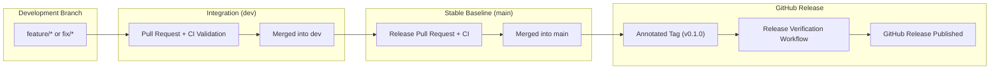

# RenewGrid — Git Workflow and Release Management

**Elevate Labs | DevOps Internship — Task 4**

## 1. Objective

Implement a structured, version-controlled development and release workflow using Git and GitHub.

This task builds on the existing RenewGrid application, CI/CD, and Terraform implementations.

## 2. Repository

**Repository:** [RenewGrid-Terraform-IaC](https://github.com/Aoun62336/RenewGrid-Terraform-IaC)

The existing repository is reused for Task 4 with approval from the internship supervisor. Earlier task implementations and evidence are preserved.

## 3. Tools

- Git and Git Bash
- GitHub
- GitHub Actions
- GitHub repository rulesets
- GitHub Releases
- Markdown documentation

## 4. Branching Strategy

| Branch | Responsibility |
| --- | --- |
| `main` | Stable release baseline |
| `dev` | Integration branch for validated changes |
| `feature/*` | Individual development improvements |
| `fix/*` | Non-emergency bug fixes |
| `hotfix/*` | Urgent fixes based directly on the stable baseline |

### Workflow Architecture



Standard integration flow:

```text
feature/* or fix/* → Pull Request → dev → Release Pull Request → main → Annotated Tag (v*) → GitHub Release
```

All direct pushes to protected branches (`main`, `dev`) are blocked. Changes are integrated exclusively through reviewed and validated pull requests.

## 5. Pull Request Governance

The pull request governance model includes:

- **Conventional Commit Messages:** Focused, descriptive commits (`feat:`, `fix:`, `docs:`, `ci:`, `chore:`, `test:`).
- **Pull Request Template:** Standardized PR description and validation checklist defined in [`.github/PULL_REQUEST_TEMPLATE.md`](.github/PULL_REQUEST_TEMPLATE.md).
- **Contribution Guidelines:** Detailed engineering guidelines defined in [`CONTRIBUTING.md`](CONTRIBUTING.md).
- **Branch Protection & Rulesets:** Enforced PR reviews and required status checks on `main` and `dev`.
- **Change Traceability:** Clean commit history preserved through controlled merges.

## 6. Automated Validation

Every pull request targeting `main` or `dev` triggers automated GitHub Actions status checks:

### Application Validation ([`pr-validation.yml`](.github/workflows/pr-validation.yml))

- **Secret Scanning:** Trivy container scans the repository filesystem for credentials, tokens, and private keys.
- **Frontend Quality:** Node.js 22 environment runs `npm run build` and `npm run lint` (ESLint).
- **Backend Quality:** Python 3.12 environment installs dependencies and executes the pytest regression test suite.

### Infrastructure Validation ([`terraform-validate.yml`](.github/workflows/terraform-validate.yml))

- **Terraform Formatting:** Verifies canonical formatting via `terraform fmt -check -recursive`.
- **Provider Initialization:** Initializes the Docker provider in read-only lockfile mode (`terraform init -backend=false -lockfile=readonly`).
- **Configuration Validation:** Validates Terraform syntax and provider parameters (`terraform validate -no-color`).
- **Compose Linting:** Validates the multi-service Docker Compose configuration using the example environment (`docker compose --env-file .env.compose.example config --quiet`).

### Release Verification ([`release-verify.yml`](.github/workflows/release-verify.yml))

- **Tag Format:** Enforces semantic version tag syntax (`vMAJOR.MINOR.PATCH`).
- **Tag Object Type:** Ensures the Git tag is an **annotated tag** (`git cat-file -t refs/tags/<tag>` equals `tag`), preserving author, date, and release notes.
- **Provenance & Ancestry:** Verifies that the tagged commit is an ancestor of `refs/remotes/origin/main` (`git merge-base --is-ancestor`), preventing unmerged release tags.

## 7. Release Management

Release versions adhere to semantic versioning:

```text
vMAJOR.MINOR.PATCH
```

### Release Sequence & Commands

1. **Integrate & Validate on `dev`:** Merge feature pull requests into `dev` after passing CI checks.
2. **Promote to `main`:** Open a release pull request from `dev` to `main`, verify required status checks, and merge.
3. **Synchronize Local Baseline:**
   ```bash
   git checkout main
   git pull origin main
   ```
4. **Update Changelog:** Ensure [`CHANGELOG.md`](CHANGELOG.md) reflects all notable additions, fixes, and changes.
5. **Create Annotated Release Tag:**
   ```bash
   git tag -a v0.1.0 -m "Release v0.1.0: Git workflow and release management baseline"
   ```
6. **Push Tag to GitHub:**
   ```bash
   git push origin v0.1.0
   ```
7. **Verify Release Workflow:** The [`release-verify.yml`](.github/workflows/release-verify.yml) workflow triggers automatically on `v*` tag push and validates provenance against `main`.
8. **Publish GitHub Release:** Publish the release on GitHub with release notes linked to [`CHANGELOG.md`](CHANGELOG.md).

## 8. Git Recovery Practices

The repository documentation establishes safe Git recovery procedures:

- **Merge vs. Rebase:** Use feature branch rebasing locally to maintain a clean linear history prior to PR submission; use controlled merges for shared integration branches (`dev`, `main`).
- **Conflict Resolution:** Resolve merge conflicts locally with clear commit explanations; never force-push to shared branches.
- **Stash Management:** Temporarily shelf uncommitted changes with descriptive labels (`git stash push -m "description"` / `git stash pop`).
- **Selective Commit Application:** Cherry-pick targeted commits across branches (`git cherry-pick <commit-sha>`) when isolated bug fixes need early promotion.
- **Safe Reverts:** Revert published shared-branch changes using non-destructive reverse commits (`git revert <commit-sha>`) via pull requests.

## 9. Evidence

Implementation evidence is organized under [`evidence/git-workflow/`](evidence/git-workflow/):

| Evidence | File | Description |
| --- | --- | --- |
| **PR Validation CI** | `01-pr-validation-ci.png` | GitHub Actions PR validation passing Trivy scanning, frontend build/lint, backend tests, and Terraform/Compose validation |
| **Branch Rulesets** | `02-branch-ruleset.png` | Protected branch rulesets for `main` and `dev` enforcing PR reviews and required status checks |
| **Release Verification** | `03-release-tag-verify.png` | GitHub Actions workflow execution verifying annotated tag `v0.1.0` format and provenance against `main` |
| **Published Release** | `04-github-release.png` | Published GitHub Release `v0.1.0` with version notes and changelog integration |

## 10. Scope

This implementation focuses on repository management, change integration, and release traceability.

It does not provision additional infrastructure, deploy a new application environment, or claim production-level release approval.

## 11. Related Work

- [Task 1 — GitHub Actions CI/CD](DEVOPS-TASK1.md) · ([GitHub Repository](https://github.com/Aoun62336/RenewGrid-DevOps))
- [Task 2 — Jenkins CI/CD on AWS EC2](DEVOPS-TASK2.md) · ([GitHub Repository](https://github.com/Aoun62336/RenewGrid-Jenkins-CICD))
- [Task 3 — Terraform Infrastructure as Code](DEVOPS-TASK3.md) · ([Workspace Documentation](DEVOPS-TASK3.md))
