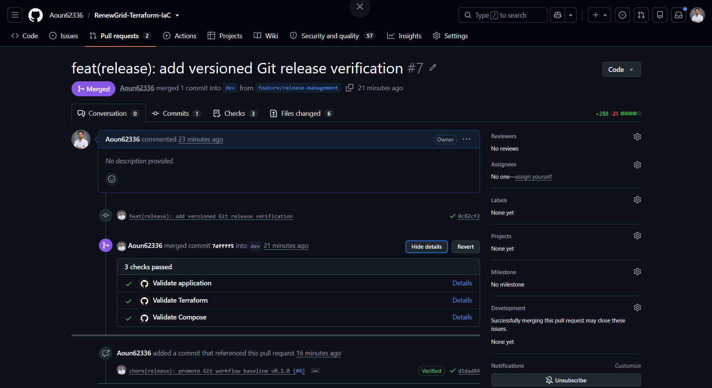
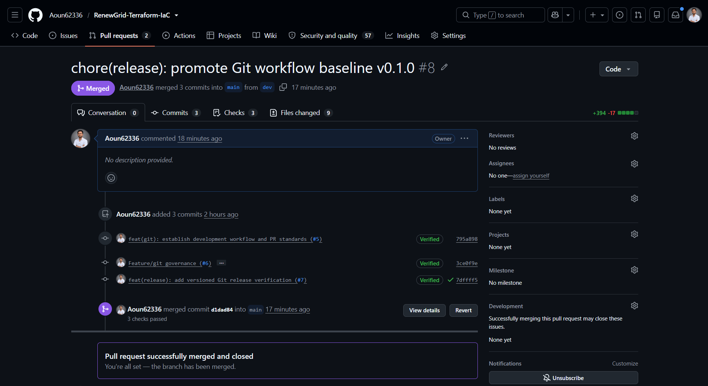
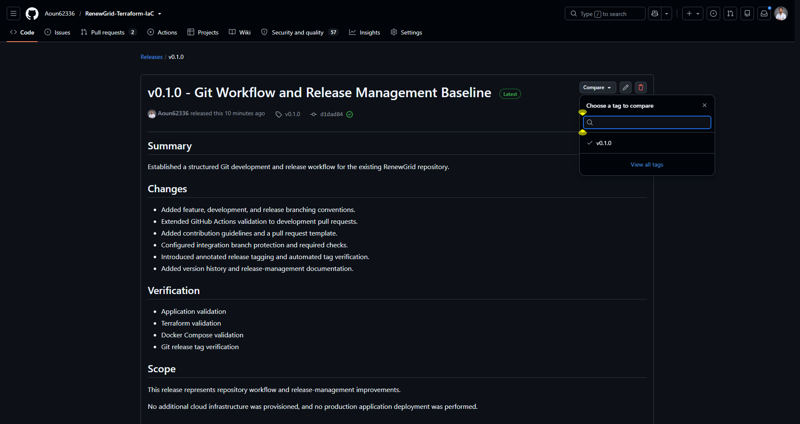

# Task 4 — Git Workflow and Release Evidence

This directory contains verification evidence for the Git branching, pull request governance, automated validation, and release management workflows implemented for **Elevate Labs DevOps Internship Task 4**.

## Evidence Catalog

| Item | File | Description |
|---|---|---|
| **Feature Integration PR** | [`01-feature-integration.png`](01-feature-integration.png) | PR #7 (`feat(release)`) merged into `dev` from `feature/release-management` with all 3 automated CI checks passing (`Validate application`, `Validate Terraform`, `Validate Compose`) |
| **Release Promotion PR** | [`02-release-promotion.png`](02-release-promotion.png) | PR #8 (`chore(release)`) promoting `dev` to `main` with all status checks verified and merged commit `d1dad84` |
| **Versioned GitHub Release** | [`03-versioned-release.png`](03-versioned-release.png) | Published GitHub Release `v0.1.0` on commit `d1dad84` with semantic version notes, verification scope, and release assets |

---

## Visual Evidence

### 1. Feature Branch Integration into `dev` (PR #7)

### 2. Release Promotion into `main` (PR #8)

### 3. Published GitHub Release `v0.1.0`

